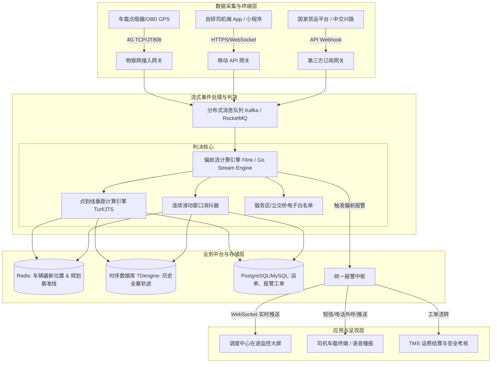

# 智能货运路径规划与实时偏航预警系统
## 系统架构设计与工程实施大纲 (Architecture & Implementation Blueprint)

---

## 1. 架构总览与业务背景 (Executive Summary)

### 1.1 业务诉求
在现代物流供应链与大宗/冷链/普货运输中，企业面临三大管理痛点：
1. **行车安全与限行风险**：货车体量大，常面临城市限行、桥梁限载、立交限高等限制，违规驶入易造成交通事故或违章扣分。
2. **司机私自绕路与油耗运费损耗**：部分司机为避开高速收费下道走省道，或私自偏离路线承揽外快，影响履约时效并增加货损风险。
3. **在途盲区脱管**：车辆进入深长隧道或偏远山区时网络信号中断，传统系统直接判为“离线”或轨迹断裂，缺乏可靠的在途追踪机制。

### 1.2 系统设计原则
- **合规前置**：在派单阶段即根据车型物理规格（长宽高重轴数）完成合法路网计算，生成唯一基准 Polyline。
- **动静结合**：结合空间几何算法与时间滑动窗口，杜绝瞬时 GPS 漂移导致的系统误报。
- **端云协同**：端侧（移动端/车载硬件）负责“高频采集 + 断网暂存”，云端（计算引擎）负责“流式判决 + 调度告警”。

---

## 2. 总体逻辑架构设计 (Logical Architecture)

系统采用典型的**分层微服务与事件驱动架构 (EDA)**：



---

## 3. 核心子系统与关键模块设计

### 3.1 路径规划子系统 (Route Planning Engine)
* **核心职责**：调用高德地图 `AMap.TruckDriving` API，输入运单起点、终点及车辆硬件参数（长、宽、高、核定载重、轴数、排放标准）。
* **产出物**：
  1. **基准折线（Base Polyline）**：一组经纬度序列 `[[lng1, lat1], [lng2, lat2], ...]`，存入 Redis 供高频计算。
  2. **约束途经点（Key Waypoints）**：在规划路径的关键互通枢纽、省界路口提取 2~4 个必经点，用于下发唤起司机第三方高德地图导航。
  3. **安全管道缓冲区（Corridor Polygon）**：根据设定的容差（如 200m）对 Polyline 进行 Buffer 外扩，生成多边形几何面。

### 3.2 偏航判定与防误报流计算引擎 (Deviation Detection Engine)
针对现实路况中的 GPS 漂移、过立交桥、进服务区加油等复杂情况，设计**四重过滤机制**：

```text
原始 GPS 坐标流
       │
       ▼
[第 1 重：坐标系校准] ──► 统一转为 GCJ-02 (消除火星坐标偏移)
       │
       ▼
[第 2 重：空间垂直距离] ──► 计算点到规划折线的垂直投影距离 D_min
       │
       ├─► D_min <= 阈值 (如 200m) ──► 判定为【正常通行】，清空计数器
       │
       ▼
[第 3 重：滑动窗口消抖] ──► D_min > 阈值，进入持续观察窗口
       │
       ├─► 仅 1~2 次超限 ──► 视为 GPS 偶发漂移，记录日志，不报警
       │
       ▼
[第 4 重：业务场景过滤] ──► 连续 >= 3 次超限 且 车速 > 10km/h 且 非服务区
       │
       ▼
   【正式触发偏航报警】
```

### 3.3 离线暂存与断网补传机制 (Store and Forward Pipeline)
针对深长隧道、山区断网场景：
1. **端侧本地落盘**：终端（App SQLite / 车载 Flash）在断网时，GPS 芯片采集的数据无条件压入本地环形队列。
2. **状态标记**：每条点位状态为 `0 (未上传)`。
3. **断点续传（双通道）**：
   - 监听到网络恢复广播时，**优先推送当前最新点**，确保监控大屏立即锁定当前真实位置。
   - 随后启动后台低优先级线程，将断网期间积压的点位**打包压缩（Gzip）批量上传**，后端接收后按时间戳补齐时序轨迹，消除历史空白断层。

---

## 4. 接口与数据交互协议规范

### 4.1 终端常规位置上报接口
* **通信协议**：HTTPS POST / MQTT 异步推流
* **上报频率**：行驶中 3~5 秒/次，静止待命 30 秒/次
* **数据包格式 (JSON)**：
```json
{
  "orderId": "ORD20261008001",
  "truckPlate": "粤B8890A",
  "sendTime": 1791452485000,
  "points": [
    {
      "lng": 113.585400,
      "lat": 23.001800,
      "speed": 72.5,
      "bearing": 135.0,
      "altitude": 12.0,
      "accuracy": 5.0
    }
  ]
}
```

### 4.2 偏航紧急事件告警推送 (WebSocket -> 调度端)
```json
{
  "eventType": "ALARM_DEVIATION",
  "truckPlate": "粤B8890A",
  "driverName": "张师傅",
  "triggerTime": 1791452520000,
  "currentLocation": { "lng": 113.560100, "lat": 23.031200 },
  "deviationDistance": 420,
  "currentRoad": "X241 县道",
  "standardRouteId": "ROUTE_GZ_DG_01"
}
```

---

## 5. 硬件与基础设施选型方案对比

| 模块 | 方案推荐 | 备选方案 | 选型权衡与决策建议 |
| :--- | :--- | :--- | :--- |
| **位置采集终端** | **点烟器/OBD GPS 硬件** | 司机端小程序（屏幕常亮） | 自有车队与长期外协首选点烟器硬件（设备50~100元/台，年卡费20元，秒级高频稳定）；临时外协调车可用小程序过渡。 |
| **重型大卡车** | **交通部中交兴路 API** | 车载硬件加装 | 4.5吨以上营运大货车出厂强制自带北斗，直接按车牌调用中交兴路在途监控包，无需司机额外操作。 |
| **流式计算引擎** | **Go 轻量流计算 / Node.js** | Apache Flink | 中小规模（5000辆车以内）用 Go/Node 内存计算 + Redis 即可满足毫秒级判决；超大型平台采用 Flink。 |
| **轨迹存储** | **TDengine / InfluxDB** | PostgreSQL (PostGIS) | 轨迹点属于标准时序数据，TDengine 压缩比与吞吐量远超传统关系型数据库。 |

---

## 6. 工程实施大纲与里程碑 (Roadmap)

### 阶段一：原型验证与算法基线建设 (第 1 ~ 2 周)
- [x] 完成高德货车 API 规划数据结构解析。
- [x] 搭建点到折线垂线距离算法模型（Turf.js 验证）。
- [x] 验证连续滑动窗口消抖模型与安全走廊缓冲区生成。
- [x] 完成调度监控大屏可视化交互原型（Demo 验收）。

### 阶段二：数据接入与上报管道打通 (第 3 ~ 4 周)
- [ ] 采购 3~5 台标准点烟器 GPS 设备，对接厂商 Webhook 推流网关。
- [ ] 完成司机端 App / 小程序“屏幕常亮 + 途经点唤起高德地图导航”能力联调。
- [ ] 搭建端侧 SQLite 离线暂存队列与网络监听重发逻辑。

### 阶段三：生产级防误报调优与复杂路况覆盖 (第 5 ~ 6 周)
- [ ] 建立高速公路服务区、加油站、收费站空间几何白名单（排除合理停靠误报）。
- [ ] 优化跨江特大桥、多层立交桥重叠路段的高程或方向角二次比对。
- [ ] 调度中心大屏接入真实 WebSocket 推送与声光预警联动。

### 阶段四：联调演练与全量上线 (第 7 ~ 8 周)
- [ ] 实际道路跟车实测：安排测试车辆在广深沿江高速进行故意下道偏航与进隧道实地测试。
- [ ] 接入 TMS 运单结算系统，形成“偏航预警 -> 调度核实 -> 运费结清/异常工单”完整闭环。
