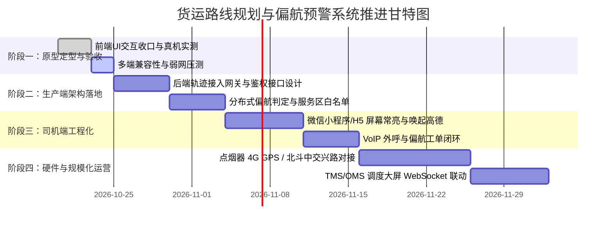

# 货运路线规划与司机端偏航预警系统实施与落地计划

## 一、 项目背景与阶段现状

本系统致力于解决物流运输中**“指定合规路线运输、严防司机脱轨绕路、实时位置监控与偏航闭环处置”**的核心诉求。

目前已完成**高保真原型系统（Demo）**的技术攻坚与功能闭环：
- [x] **高德 3D 车头朝上导航**：实现车速 60FPS 平滑插值、车头正立居中下沉、动态红黄绿路况流（TMC）呈现。
- [x] **多层级路线选择**：支持大湾区精品专线一键秒切、全国任意起终点高德官方 API 智能算路及地图点选。
- [x] **车端全屏偏航声光报警**：基于 Turf.js 空间垂线算法，连续 3 次偏离管道（>250m）触发红晕闪烁、双频警报、语音播报及震动；提供司机“我知道了”交互。
- [x] **离线暂存与断网续传**：集成 LocalStorage 暂存队列、防并发批量上报与网络自愈机制。

---

## 二、 整体推进路线图 (Roadmap)

---

## 三、 四阶段分步实施计划

### 阶段一：现有 Demo 完善与真机实地验收（第 1 ~ 2 周）

* **目标**：验证产品体验，在实地车辆中验证 H5 定位与偏航报警算法。
* **核心任务**：
  1. **真车道路实测**：
     * 携带测试手机在实际道路驾车行驶，检验 `watchPosition` 在车速 40~100 km/h 下的平滑度和方向稳定性。
     * 实地故意下高速或驶入辅道，检验离开安全管道 250m 后是否准确触发报警。
  2. **端侧性能与耗电评估**：
     * 测试长时间导航下的发热、耗电与浏览器防锁屏（`WakeLock API`）稳定性。
  3. **交付物**：
     * 《真机道路实测与定位稳定性验证报告》
     * 确认定型的司机端交互原型

---

### 阶段二：生产级服务端架构与数据网关建设（第 3 ~ 4 周）

* **目标**：将前端模拟的本地离线存储，升级为高并发的企业级云端采集与判定服务。
* **核心任务**：
  1. **高并发轨迹接入网关（Ingress Gateway）**：
     * 协议选型：支持 HTTP REST 批量上报（断网补传）与 **MQTT / WebSocket** 长连接轻量推流。
     * 报文结构统一：包含车辆车牌（`truckPlate`）、运单ID（`waybillId`）、经纬度（WGS84/GCJ02）、车速、航向角、定位精度与设备时间戳。
  2. **服务端分布式偏航计算引擎**：
     * 将 Turf.js 算法移植至服务端（Java JTS 或 Node.js 后台微服务）。
     * **服务区/加油站白名单机制**：在规划路线上解析出沿途服务区多边形，车辆进入服务区休息或加油时挂起偏航计时。
     * **立交桥垂直高差防误报**：结合高德地图道路等级判定，避免高架桥下辅道误报。
  3. **交付物**：
     * 《车载数据上报协议标准规范 v1.0》
     * 生产级高可用轨迹接入与偏航检测微服务

---

### 阶段三：司机端多端产品化与调度联动（第 5 ~ 6 周）

* **目标**：将 H5 封装为司机日常最便捷的使用形态（微信小程序或企业 APP）。
* **核心任务**：
  1. **司机端微信小程序开发**：
     * 引入微信 `wx.setKeepScreenOn` 确保行车导航全程屏幕常亮。
     * 支持**一键调起手机高德地图 App 导航（带 2~4 个强制途经点）**，司机看高德听语音，小程序在后台保持低功耗持续推流。
  2. **调度监控大屏联动**：
     * 调度中心 Web 大屏（Vue3 / OMS）接入 WebSocket 报警通道。
     * 地图实时标红脱轨车辆，并绘制“蓝色标准合规路线 vs 红色实际行驶轨迹”。
  3. **偏航处置工单闭环**：
     * 偏航超过 10 分钟或累计 3 次未归位，系统自动生成异常工单，支持调度员一键外呼司机手机。
  4. **交付物**：
     * 司机端小程序生产版本
     * TMS 调度中心实时偏航大屏模块

---

### 阶段四：硬件融合与规模化运营（第 7 ~ 8 周）

* **目标**：摆脱纯手机易被司机退出、锁屏杀进程的局限，建立不可篡改的硬件保障。
* **核心任务**：
  1. **硬件双轨制方案落地**：
     * **自有/长期协议车队**：采购 **点烟器/OBD 4G GPS 硬件**（成本约 50~80元/台，年流量费 20元），插电即自动开机稳定推流，具备拔出断电报警功能。
     * **外协社会临时黄牌卡车**：对接**交通部全国货运平台（中交兴路 API）**，直接通过车牌号实时获取车载前装北斗定位，零硬件投入。
  2. **系统全面联调与容灾**：
     * 压测单节点支撑 5,000+ 台货车同时以 1 秒频次上报，轨迹入库与偏航判定平均延时低于 50ms。
  3. **交付物**：
     * 车联网硬件批量部署指南
     * 生产环境上线与运营监控大盘

---

## 四、 核心风险与应对策略

| 风险点 | 潜在影响 | 针对性应对策略 |
| :--- | :--- | :--- |
| **手机锁屏/切后台** | 浏览器/小程序 JS 线程被系统休眠，导致轨迹丢失 | ① 小程序开启全屏常亮；② 调度端增加“心跳断流报警”（超 60 秒无心跳主动预警）；③ 中长期推广点烟器 GPS 硬件。 |
| **高架桥/立交立交重叠** | 地面道路与高架桥垂直重叠导致距离算法误判 | 增加车速阈值与道路类型判断（高架最低车速通常高于辅道）；连续 3 次判定且距离大于 250m 才触发。 |
| **高德 API 商业调用配额** | 频繁规划导致接口配额超限或费用增加 | 对干线大宗路线做预计算与 GeoJSON 数据库缓存；仅对首次下单或司机临时改变目的地时调取在线规划。 |
| **网络盲区（偏远山区/长隧道）** | 无法实时上传报警 | 依赖端侧 `OfflineStorageEngine` 本地加密暂存，出隧道恢复网络后原子化批量补传，云端自动补齐历史偏离记录。 |

---

## 五、 近期行动项清单 (Next Actions)

1. **[今明两天] 团队评审**：内部评审本计划书，确认第一阶段实测重点；
2. **[技术端] 接口联调**：将前端 [`js/offlineStorage.js`](file:///c:/Users/wtadmin/Desktop/truck-route-deviation-demo/js/offlineStorage.js) 的 `uploadApiUrl` 对接至真实测试后端服务器；
3. **[设备端] 样机试用**：选型并采购 2 台 4G 点烟器定位器用于对比纯手机 H5 与物理硬件的精度差异。
